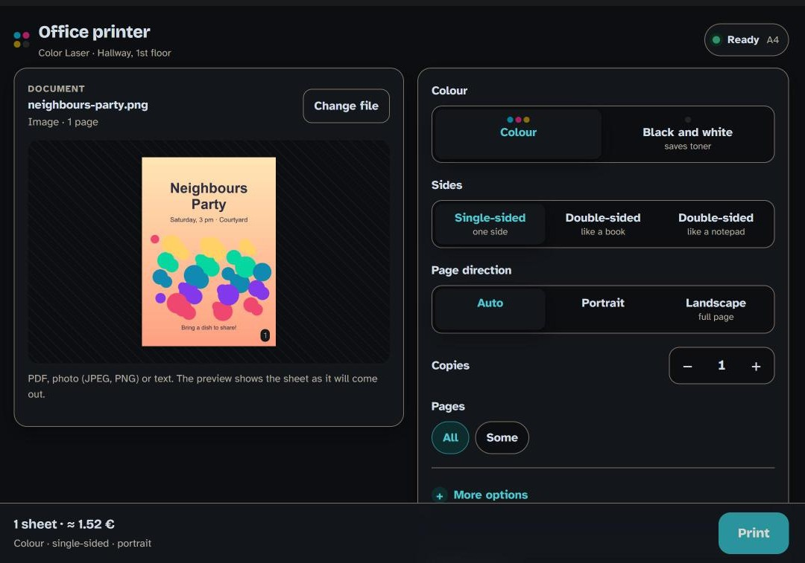

# printer-web

Print from your phone to the family printer: open a web page, pick a file, tap Print. Self-hosted, one small container, no app and no account.

<p align="center"></p>

## Features

- Print from any phone browser: PDF, PostScript, JPEG, PNG, GIF, TIFF, BMP, HEIC/HEIF photos and plain text
- Preview before printing
- Colour or black and white, duplex, number of copies, page selection, paper size and tray
- A shared queue, so everyone sees what is printing and what is waiting
- Printer status and supplies (toner, paper, covers) when the printer reports them
- Optional cost estimate per job
- A printable QR code (small sticker to cut out, or A4 poster) so guests can open the page by scanning it
- Works offline: no CDN, every script and font is bundled
- No accounts, no cloud
- French and English interface

## Quick start

```sh
docker run -d --name printer-web --restart unless-stopped \
  -p 28431:28431 \
  -e PRINTER_URI=ipp://192.168.1.50/ipp/print \
  ghcr.io/kipavy/printer-web
```

Then open `http://<server-ip>:28431` on your phone (same Wi-Fi as the server).

With Docker Compose:

```yaml
services:
  printer-web:
    image: ghcr.io/kipavy/printer-web
    restart: unless-stopped
    stop_grace_period: 15s   # printer-web stops within 10 s; this leaves a margin
    ports:
      - "28431:28431"
    environment:
      PRINTER_URI: ipp://192.168.1.50/ipp/print
      PRINTER_NAME: Office printer
```

Settings can also live in a file: copy [`examples/.env.example`](examples/.env.example) to `.env` and use `--env-file .env` (or `env_file:` in Compose).

## Configuration

Everything is set with environment variables.

| Variable | Default | Description |
|---|---|---|
| `LISTEN_ADDR` | `:28431` | Address and port to listen on. |
| `PUBLIC_URL` | (from the request) | Address shown in the QR poster, e.g. `http://192.168.1.10:28431` (must start with `http://` or `https://`). Also allows that host name (see Security). |
| `PRINTER_NAME` | `Printer` | Name shown in the UI and on the poster. |
| `PRINTER_LOCATION` | empty | Where the printer is, shown on the poster. |
| `PRINTER_BACKEND` | `ipp` | `ipp`, `cups`, `raw` or `command`. |
| `PRINTER_URI` | empty | `ipp://` or `ipps://` URI for `ipp`/`cups` (`http://` and `https://` work too); `socket://host[:9100]` for `raw`. Required for those three backends. |
| `PRINTER_TLS_INSECURE` | `false` | Accept a self-signed certificate on `ipps://`. |
| `PRINTER_RAW_LANGUAGE` | `ps` | `raw` only: `ps` (PostScript) or `pcl`. |
| `PRINTER_COMMAND` | empty | `command` only, required: a JSON array of strings, run without a shell. See the tokens below. |
| `PRINTER_PROBE` | empty | `command` only, optional: `host:port` of the printer, e.g. `192.168.1.50:9100`. When set, the printer shows as unreachable when that port does not answer, and jobs are not sent to a printer that is off. |
| `PRINTER_SNMP` | empty | `raw` and `command`, optional: `host` or `host:port` (port 161) of the printer's SNMP agent, e.g. `192.168.1.50`. Shows toner levels and paper, jam and cover alerts. Used by `ipp`/`cups` only for toner levels the printer does not report over IPP. If SNMP does not answer, the page just shows no levels. |
| `PRINTER_SNMP_COMMUNITY` | `public` | SNMP v1 community for `PRINTER_SNMP`. |
| `PRINTER_COLOR` | `false` | Declare a colour printer (`raw` and `command`; IPP printers report it themselves). |
| `PRINTER_DUPLEX` | `false` | Declare two-sided printing (`raw` and `command`). |
| `PRINTER_PAPERS` | `A4` | Comma-separated paper names (`raw` and `command`). The first is the default. No spaces inside a name. |
| `PRINTER_TRAYS` | empty | Comma-separated tray names (`raw` and `command`). No spaces inside a name. |
| `PRINTER_MODEL` | empty | Model name shown on the printer page. |
| `PRINTER_PPM` | `0` | Pages per minute, shown on the printer page. |
| `PRINTER_DPI` | `0` | Resolution, shown on the printer page. |
| `DEFAULT_LANG` | `auto` | `auto` (browser language), `fr` or `en`. |
| `QUEUE_SHOW_NAMES` | `false` | Show other people's file names in the shared queue. |
| `MAX_UPLOAD_MB` | `50` | Maximum upload size in MB (greater than 0). |
| `DRAFT_TTL` | `15m` | How long an uploaded but unprinted file is kept (Go duration, e.g. `30m`). |
| `PRICE_CURRENCY` | `€` | Currency symbol for the cost estimate. |
| `PRICE_SHEET` | empty | Cost of one sheet of paper. |
| `PRICE_TONER_C`, `PRICE_TONER_M`, `PRICE_TONER_Y`, `PRICE_TONER_K` | empty | Price of one cartridge per colour. |
| `YIELD_TONER_C`, `YIELD_TONER_M`, `YIELD_TONER_Y`, `YIELD_TONER_K` | empty | Pages one cartridge prints at 5 % coverage. Must be set together with the matching price. |

Booleans accept `true`/`false`, `1`/`0`, `yes`/`no`. Numbers use a decimal point. A wrong value stops the server at start with a clear message.

## Choosing a backend

- **IPP / AirPrint (`ipp`)**: the right choice for most printers made in the last ten years. Set `PRINTER_URI=ipp://<printer-ip>/ipp/print` (the path is often `/ipp/print`, `/ipp` or `/ipp/printer`; check the printer's web page or manual). Colour, duplex, paper, trays, status and supplies are read from the printer, and job progress is tracked.
- **CUPS queue (`cups`)**: you already run CUPS and want to reuse a queue. Use `ipp://<cups-host>:631/printers/<queue>`. It behaves like IPP.
- **Raw port 9100 (`raw`)**: for PostScript or PCL printers without IPP. Use `PRINTER_URI=socket://<printer-ip>` (port 9100 by default) and `PRINTER_RAW_LANGUAGE=ps` or `pcl` (PCL means PCL XL, also called PCL 6). Declare what the printer can do with `PRINTER_COLOR`, `PRINTER_DUPLEX` and `PRINTER_PAPERS`; two-sided printing is requested in the job itself. Pages are scaled to the chosen paper. Progress is not tracked.
- **Command (`command`)**: for anything else, such as a vendor tool or `lp`. You give a command line as a JSON array; printer-web runs it once per job with the PDF to print. Progress is not tracked: the job is "sent" when the command exits successfully. Set `PRINTER_PROBE` so the page knows when the printer is off.

Toner levels and paper alerts for `command`/`raw` printers: set `PRINTER_SNMP` to the printer's address. printer-web then reads the toner levels and the paper, jam and cover alerts over SNMP v1 (standard Printer MIB, plus Ricoh's own toner table), every 10 seconds at most. An empty tray or a jam then shows on the page before anyone prints. Whether the printer is on is still decided by `PRINTER_PROBE` or the raw socket, never by SNMP.

### Setting `PRINTER_COMMAND`

The value is JSON, so its double quotes must reach printer-web untouched:

- In an `--env-file` / `env_file:` file, write it as is, with no quotes around it:
  ```sh
  PRINTER_COMMAND=["lp","-d","office","-n","{copies}","{file}"]
  ```
- In compose YAML, wrap the whole value in single quotes:
  ```yaml
      environment:
        PRINTER_BACKEND: command
        PRINTER_COMMAND: '["lp","-d","office","-n","{copies}","{file}"]'
  ```
- With `docker run -e`, wrap the whole `NAME=value` in single quotes (POSIX shells):
  ```sh
  docker run -d -p 28431:28431 -e PRINTER_BACKEND=command \
    -e 'PRINTER_COMMAND=["lp","-d","office","-n","{copies}","{file}"]' \
    ghcr.io/kipavy/printer-web
  ```

If the value is not valid JSON the server stops at start and prints what it received.

### Command tokens

`PRINTER_COMMAND` is a JSON array like `["my-tool","print","{file}","--copies","{copies}"]`. Each element is one argument. There is no shell, so nothing is split or expanded again.

| Token | Value |
|---|---|
| `{file}` | Absolute path of the PDF to print |
| `{name}` | Document name (leading `-` removed) |
| `{copies}` | Number of copies, 1 to 99 |
| `{duplex}` | `none`, `long` or `short` |
| `{color}` | `color` or `mono` |
| `{paper}` | Chosen paper name (the first `PRINTER_PAPERS` entry if none was sent) |
| `{orientation}` | `portrait` or `landscape`. "Auto" is resolved from the first page of the document; `auto` only when that page could not be read |
| `{quality}` | `fast`, `standard` or `fine`, or empty |
| `{tray}` | Chosen tray name, or empty |
| `{mono_flag}` | A whole element: becomes `--mono` for black and white, otherwise it is dropped |
| `{landscape_flag}` | A whole element: becomes `--landscape` for landscape (including "Auto" with a landscape first page), otherwise it is dropped |

Tips:

- An element that expands to nothing is dropped. With `["tool","--tray","{tray}"]` and no tray, the command becomes `tool --tray`, and `--tray` swallows whatever comes next. Prefer the single-element form `"--tray={tray}"` for values that can be empty (`{tray}`, `{quality}`): it stays a well-formed `--tray=`.
- Paper, tray and quality values may only contain letters, digits and `. _ + x -`, and must not start with `-`. So declared tray and paper names cannot contain spaces: write `Tray1`, not `Tray 1`.
- The first element (the program) must be on the container's `PATH`. Build a derived image to add your tool (see the Ricoh example).

## Cost estimate

Set the prices and page yields of your cartridges and each job shows an estimated cost before printing. Everything is optional.

```sh
PRICE_CURRENCY=€
# One sheet of paper.
PRICE_SHEET=0.01
# Black cartridge price, and the pages it prints at 5 % coverage.
PRICE_TONER_K=60
YIELD_TONER_K=3000
# Same for C, M and Y.
PRICE_TONER_C=80
YIELD_TONER_C=2500
```

Keep comments on their own lines: env files do not strip a `#` at the end of a value.

How it works: cartridge makers quote yields at 5 % ink coverage per colour. printer-web measures the real coverage of each page (with Ghostscript) and computes, per colour, `coverage / 5 % x price / yield`. The total is that sum over the selected pages and copies, plus the paper cost of the sheets (duplex uses half as many). In black and white only black toner counts, with the colours folded in as grey. A price needs its yield (and the other way round), otherwise the server refuses to start. It is an estimate, not an invoice.

## QR poster

Open `/qr` (for example `http://<server-ip>:28431/qr`) and tap **Print a small sticker to cut out**: a 5 cm QR code with the address underneath (never wider than the code), inside a dashed cut line in the corner of the sheet. **Print this poster (A4)** gives a full-page version instead. Set `PUBLIC_URL` first so the code carries the address you want people to use.

## Add to home screen

On a phone, open the page, then use the browser menu: **Share, Add to Home Screen** on iPhone, **Install app** or **Add to Home screen** on Android. printer-web then opens like an app.

## Security

printer-web has no login. Anyone who can reach the port can print and see the queue, so:

- Run it on your home or office network only. **Never expose it to the internet** (no port forwarding, no public reverse proxy).
- Changes need a custom header or a JSON content type, which blocks simple cross-site requests. The visitor cookie only separates people's jobs, it is not a login.
- A Host-header guard blocks DNS-rebinding attacks: the server only answers when it is reached by IP address, `localhost`, a name ending in `.local`, `.lan`, `.home.arpa` or `.internal`, or the host of `PUBLIC_URL`. If you use another DNS name, or a single-label host such as `http://printbox:28431`, set `PUBLIC_URL` to that address, otherwise requests are refused.
- Uploads are limited in size (`MAX_UPLOAD_MB`), type-checked by content, processed by Ghostscript in `-dSAFER` mode, and deleted when the job ends or after `DRAFT_TTL`. Files left by a crash are deleted at the next start.
- Logs carry job ids and errors, never file contents. They do not include file names, unless your own `PRINTER_COMMAND` prints `{name}` in its error output.
- The container runs as an unprivileged user.

## Example: Ricoh SP C240DN

The Ricoh Aficio SP C240DN only speaks a proprietary GDI protocol. [ricoh-spc240](https://github.com/kipavy/ricoh-spc240) is a small driver for it, and printer-web can call it through the `command` backend. [`examples/ricoh/`](examples/ricoh) has a Dockerfile that adds the driver to the printer-web image and an `.env.example` with the matching command:

```sh
docker build -t printer-web-ricoh examples/ricoh
cp examples/ricoh/.env.example .env      # set your printer's address after --printer
docker run -d --name printer-web --restart unless-stopped \
  -p 28431:28431 --env-file .env printer-web-ricoh
```

The example also sets `PRINTER_SNMP` to the same address, so the page shows the four toner levels and warns when the tray is empty or paper is jammed.

## Development

```sh
go vet ./...
go test ./...
PRINTER_BACKEND=command PRINTER_COMMAND='["true"]' go run ./cmd/printer-web
```

Go standard library only. Tests that need `ghostscript`, `enscript`, `libheif-tools` or `tiff-tools` are skipped when a tool is missing. The integration test also needs `ippeveprinter` (package `cups-ipp-utils`). Build the image with `docker build -t printer-web .`.

## License

[MIT](LICENSE)
